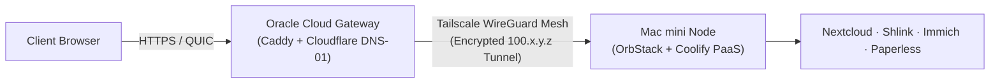

For years, self-hosting at home came with unavoidable compromises: noisy enterprise server racks, surging electric bills, fragile dynamic DNS scripts, and the inherent security risks of opening ports on your home router.

Today, modern networking and virtualization primitives have completely reshaped the self-hosting landscape. In this post, we explain how we designed and deployed the **MBA Bros Private Cloud**—a zero-trust, high-density infrastructure running on an Apple Silicon Mac mini and an Oracle Cloud Always-Free edge gateway.

---

## The Core Design Requirements

When we set out to re-architect our private cloud, we established non-negotiable architectural requirements:

1. **Zero Open Ports at Home:** No port forwarding on the residential NAT router. Immunity to port scanning, brute-force bots, and ISP CGNAT limitations.
2. **Instant Wildcard SSL:** Automated Let's Encrypt certificates for `*.mbabros.com` without relying on HTTP port 80 domain validation.
3. **HTTP/3 (QUIC) Acceleration:** Accelerated page loading and WebSocket reliability over UDP.
4. **Low Power Consumption:** Sub-20W average power draw to maintain whisper-quiet operation and negligible electricity cost.
5. **100% Codified GitOps:** Zero manual configuration drifts. All Caddy routing rules, firewall tables, and Docker stacks version-controlled in Git.

---

## The Architecture at a Glance

### 1. The Cloud Ingress Edge: Oracle Cloud + Caddy
Rather than exposing our home IP, we provisioned an **OCI Always Free ARM Ampere A1** instance. With 4 OCPUs and 24GB of RAM permanently free of charge, it acts as an unyielding cloud bastion.

On this VM, we run **Caddy** compiled with the Cloudflare DNS module (`caddy-dns/cloudflare`). Caddy interacts directly with Cloudflare's API to solve DNS-01 ACME challenges, issuing Let's Encrypt wildcard certificates (`*.mbabros.com`) seamlessly in the background.

### 2. The Private Mesh: Tailscale WireGuard
To bridge the OCI gateway to the Mac mini in our home office, we use **Tailscale**. Tailscale creates an encrypted point-to-point WireGuard mesh. Traffic never touches an unauthenticated public interface. The Mac mini establishes an outbound UDP connection; no inbound ports are opened on the router.

### 3. The Powerhouse: Mac mini M2 & Coolify PaaS
At the center of our home network sits an Apple Silicon Mac mini running **OrbStack**. With ultra-low memory overhead and instant container boot times, it hosts **Coolify**, our self-hosted PaaS controller.

Coolify orchestrates our application inventory—Nextcloud, Microbin, Immich, Karakeep, and Paperless-ngx—while handling database provisioning, environment variables, and daily encrypted S3 backups.

---

## Lessons Learned & Key Takeaways

* **Wildcard DNS-01 is a Game Changer:** Managing per-container SSL certificates inside your local network is complex and error-prone. By terminating wildcard TLS once at the cloud edge, internal apps can operate over secure HTTP within the WireGuard mesh.
* **Apple Silicon is the Future of Homelabs:** Replacing bulky x86 server hardware with an M-series Mac mini reduced our idle power consumption from 180 Watts to under 7 Watts, with zero fan noise.

In our next article, we will dive deep into how we automate Caddy testing and deployments using GitHub Actions!
