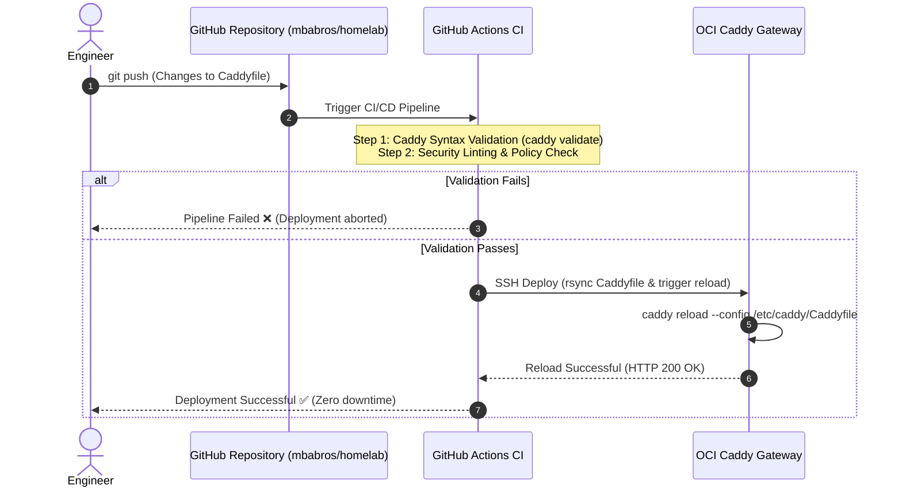

One of the most dangerous anti-patterns in self-hosting is editing live reverse proxy configurations directly on production hosts via SSH. A single misplaced bracket or invalid directive can take down all subdomains simultaneously.

To prevent outages, the **ExCloudVault.com** private cloud enforces a strict GitOps deployment model for Caddy using **GitHub Actions**.

---

## The GitOps Workflow Lifecycle



---

## 1. Automated Syntax Validation in CI

Before any Caddyfile change reaches production, GitHub Actions validates the syntax using the official Caddy Docker image:

```yaml
name: Validate Caddyfile

on:
  pull_request:
    paths:
      - 'Caddyfile'
  push:
    branches:
      - main
    paths:
      - 'Caddyfile'

jobs:
  validate:
    name: Lint & Validate Syntax
    runs-on: ubuntu-latest
    steps:
      - name: Checkout Code
        uses: actions/checkout@v4

      - name: Validate Caddyfile Syntax
        run: |
          docker run --rm -v $(pwd)/Caddyfile:/etc/caddy/Caddyfile:ro \
            caddy:2-alpine caddy validate --config /etc/caddy/Caddyfile
```

If a typo or syntax error exists, the pipeline halts immediately, preventing broken configurations from ever being deployed.

---

## 2. Zero-Downtime Hot Reloading

Unlike Nginx, which often requires process restarts or complex signal handling, Caddy features a native API and CLI command for dynamic, zero-downtime configuration reloads:

```bash
docker exec caddy caddy reload --config /etc/caddy/Caddyfile
```

Caddy parses the new configuration in memory. If valid, it hot-swaps active listener sockets without dropping in-flight TCP connections or terminating active WebSocket sessions. If the new config contains an operational error, Caddy rolls back immediately to the previous running configuration in memory.

---

## 3. Production Deployment Step

Once the syntax is verified, the deployment job connects to the OCI gateway via SSH (using GitHub Secrets for private keys):

```yaml
  deploy:
    name: Deploy to Edge Gateway
    needs: validate
    if: github.ref == 'refs/heads/main'
    runs-on: self-hosted # Or ubuntu-latest with Tailscale action
    steps:
      - name: Checkout Code
        uses: actions/checkout@v4

      - name: Sync Caddyfile & Reload
        env:
          SSH_KEY: ${{ secrets.OCI_SSH_KEY }}
          HOST: ${{ secrets.OCI_HOST }}
        run: |
          echo "$SSH_KEY" > key.pem && chmod 600 key.pem
          scp -i key.pem Caddyfile ubuntu@$HOST:/opt/caddy/Caddyfile
          ssh -i key.pem ubuntu@$HOST "docker exec caddy caddy reload --config /etc/caddy/Caddyfile"
          rm -f key.pem
```

---

## Summary

With automated syntax checking, zero-downtime hot reloading, and GitOps versioning, our team can add new services or modify routing rules with complete confidence. Every change is peer-reviewed in pull requests, and production remains reliable and resilient.
