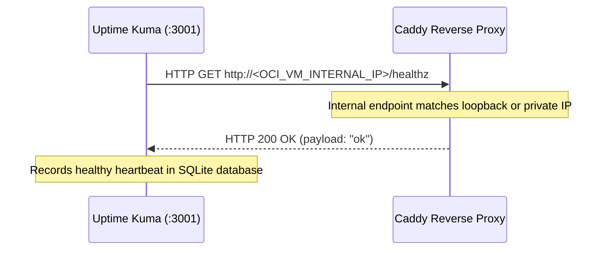

In this blueprint, we examine the deployment, database persistence, and internal networking strategies for the core edge and monitoring services: **Shlink URL Shortener**, **Uptime Kuma v2.5.9**, and **Gotify**.

---

## 1. Shlink URL Shortener Stack

Shlink is a self-hosted, open-source URL shortener that provides granular click analytics, custom short domains, and REST APIs.

### Docker Compose Configuration (`/opt/shlink/docker-compose.yml`)

```yaml
services:
  shlink:
    image: shlinkio/shlink:stable # v5.1.8
    container_name: shlink
    restart: unless-stopped
    depends_on:
      shlink-db:
        condition: service_healthy
    environment:
      - DEFAULT_DOMAIN=shlink.mbabros.com
      - IS_HTTPS_ENABLED=true
      - DB_DRIVER=maria
      - DB_NAME=shlink
      - DB_USER=shlink
      - DB_PASSWORD=${SHLINK_DB_PASSWORD}
      - DB_HOST=shlink-db
      - DB_PORT=3306
      - GEOLITE_LICENSE_KEY=${MAXMIND_LICENSE_KEY}
    networks:
      - npm_net

  shlink-db:
    image: mariadb:10.11
    container_name: shlink-db
    restart: unless-stopped
    environment:
      - MYSQL_ROOT_PASSWORD=${MYSQL_ROOT_PASSWORD}
      - MYSQL_DATABASE=shlink
      - MYSQL_USER=shlink
      - MYSQL_PASSWORD=${SHLINK_DB_PASSWORD}
    volumes:
      - shlink_db_v2:/var/lib/mysql
    healthcheck:
      test: ["CMD", "healthcheck.sh", "--connect", "--innodb_initialized"]
      interval: 10s
      timeout: 5s
      retries: 5
    networks:
      - npm_net

volumes:
  shlink_db_v2:
    name: shlink_shlink_db_v2

networks:
  npm_net:
    name: nginx-proxy-manager_default
    external: true
```

### Key Architectural Safeguards:
1. **Zero Host Port Collision:** Notice that neither `shlink` nor `shlink-db` publishes ports to the host interface (`ports:` block is intentionally omitted). Caddy communicates with Shlink via Docker bridge DNS (`http://shlink:8080`).
2. **Persistent Named Volumes:** MariaDB stores all data in the named volume `shlink_shlink_db_v2`. During container updates, data is never wiped.

---

## 2. Uptime Kuma Monitoring Stack (v2.5.9)

Uptime Kuma monitors service availability and sends instant push alerts if any node or route goes down.

### Docker Compose Definition (`/opt/uptime-kuma/docker-compose.yml`)

```yaml
services:
  uptime-kuma:
    image: louislam/uptime-kuma:2 # v2.5.9
    container_name: uptime-kuma
    restart: unless-stopped
    ports:
      - "127.0.0.1:3001:3001" # Bound strictly to loopback
    volumes:
      - /home/ubuntu/uptime-kuma-data:/app/data
    networks:
      - npm_net

networks:
  npm_net:
    name: nginx-proxy-manager_default
    external: true
```

### Heartbeat Probe: Option A `/healthz`
Rather than relying on legacy web dashboards, Uptime Kuma queries a dedicated health probe configured inside Caddy:



---

## 3. Automated Disaster Recovery & Snapshots

Before running major version upgrades on database-backed containers (e.g. migrating Uptime Kuma v1 to v2), automated tarball snapshots are generated:

```bash
# 1. Stop container gracefully
docker stop uptime-kuma

# 2. Archive SQLite data directory
tar -czvf /home/ubuntu/uptime-kuma-data-v1-backup.tar.gz -C /home/ubuntu uptime-kuma-data

# 3. Pull new image and restart
docker compose pull && docker compose up -d
```

With these codified patterns, every service in your private cloud can be rebuilt from scratch in minutes!
