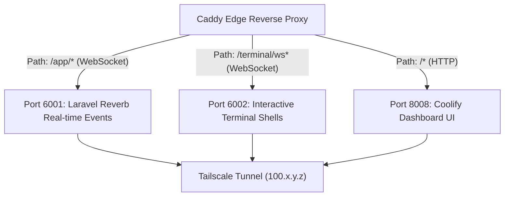

Traditional enterprise servers require noisy server racks, massive power draw, and complex hypervisors. By using an **Apple Silicon Mac mini** running **OrbStack** and **Coolify**, you achieve workstation-class performance and low latency while consuming less than 15 Watts under typical homelab loads.

---

## 1. Why Apple Silicon & OrbStack?

* **Extreme Power Efficiency:** An Apple Silicon M-series Mac mini idles at ~4-7 Watts and consumes ~15-25 Watts under heavy container workloads.
* **Unified Memory Architecture (UMA):** High memory bandwidth allows fast database queries, indexing, and container startups without bus bottlenecks.
* **OrbStack Virtualization:** A native macOS virtualization engine that replaces Docker Desktop. It boots in ~2 seconds, consumes a fraction of the RAM, and provides native macOS-to-Linux networking.

---

## 2. Deploying Coolify PaaS

[Coolify](https://coolify.io) is an open-source, self-hosted alternative to Heroku, Netlify, and Render. It provides:
* Automatic container builds from Git repositories.
* Pre-configured one-click templates for 100+ open-source services.
* Automated PostgreSQL, MySQL, and Redis scheduled backups to S3/Backblaze.
* Built-in multi-server management.

### Installation Command

On your Mac mini terminal:

```bash
curl -fsSL https://cdn.coolify.io/install.sh | bash
```

Once installed, Coolify launches three core containers:
1. `coolify` (Laravel application server & dashboard)
2. `coolify-db` (PostgreSQL 15 metadata storage)
3. `coolify-redis` (Real-time queue broker & caching)

---

## 3. Coolify Networking & WebSockets Architecture

Coolify splits its traffic across three distinct ports:



### Caddy Reverse Proxy Snippet

To route Coolify cleanly through Caddy over Tailscale, use dedicated matchers:

```nginx
@coolify host coolify.mbabros.com
handle @coolify {
    # WebSocket endpoint for real-time build logs and notifications
    @ws_events path /app/*
    handle @ws_events {
        reverse_proxy 100.x.y.z:6001
    }

    # WebSocket endpoint for web terminal SSH shell sessions
    @ws_term path /terminal/ws*
    handle @ws_term {
        reverse_proxy 100.x.y.z:6002
    }

    # Main dashboard UI
    handle {
        reverse_proxy 100.x.y.z:8008
    }
}
```

---

## 4. Self-Hosted GitHub Actions Runner

To achieve continuous deployment without exposing webhooks to the public internet, deploy a self-hosted GitHub Actions runner directly on the Mac mini:

```bash
# Create runner workspace
mkdir -p ~/actions-runner && cd ~/actions-runner

# Download runner package for macOS arm64
curl -o actions-runner-osx-arm64.tar.gz -L https://github.com/actions/runner/releases/download/v2.321.0/actions-runner-osx-arm64-2.321.0.tar.gz
tar xzf ./actions-runner-osx-arm64.tar.gz

# Configure with your repository token
./config.sh --url https://github.com/mbabros/homelab --token <YOUR_RUNNER_REGISTRATION_TOKEN> --name "mac-mini-homelab" --labels "self-hosted,macOS,arm64"

# Install as a background LaunchAgent daemon
./svc.sh install
./svc.sh start
```

This runner executes local builds and deployment pipelines automatically whenever changes are pushed to your infrastructure repository!
