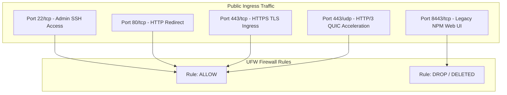

Because the edge gateway resides on a public IP in Oracle Cloud, maintaining a hardened host firewall policy is vital. Every opened port represents an attack vector.

---

## 1. Edge Firewall Policy Architecture



### Key Security Decisions
1. **HTTP/3 QUIC Support (443/udp):** Modern browsers automatically upgrade to HTTP/3. Without `443/udp` explicitly allowed in both OCI Security Lists and UFW, QUIC connections fail back to TCP with a latency penalty.
2. **Administrative Port Deletion (8443/tcp):** Legacy reverse proxy managers often expose administrative web panels on public ports like `81` or `8443`. In our codified architecture, all administrative UI exposure is completely deleted across IPv4 and IPv6 chains. Configuration is managed via code and GitOps.
3. **Tailscale Interface Trust (`tailscale0`):** Traffic originating on the authenticated WireGuard overlay interface is fully trusted for internal routing.

---

## 2. Hardening Script with UFW

Execute the following commands on the OCI gateway host:

```bash
# 1. Reset UFW to secure baseline
sudo ufw default deny incoming
sudo ufw default allow outgoing

# 2. Allow SSH (with rate limiting)
sudo ufw limit 22/tcp comment 'Rate-limited SSH'

# 3. Allow Public Ingress
sudo ufw allow 80/tcp comment 'HTTP Redirect'
sudo ufw allow 443/tcp comment 'HTTPS TLS'
sudo ufw allow 443/udp comment 'HTTP/3 QUIC'

# 4. Explicitly remove any legacy web admin ports
sudo ufw delete allow 8443/tcp 2>/dev/null || true
sudo ufw delete allow 81/tcp 2>/dev/null || true

# 5. Allow unrestricted traffic on the Tailscale mesh overlay interface
sudo ufw allow in on tailscale0 comment 'Tailscale overlay interface'

# 6. Enable firewall
sudo ufw --force enable
sudo ufw status verbose
```

---

## 3. Verifying HTTP/3 QUIC Acceleration

Once Caddy and UFW are configured, verify that HTTP/3 datagrams are transmitted and received over UDP:

```bash
# Query with curl supporting HTTP/3
curl -Iv --http3 https://shlink.mbabros.com/

# Check UDP socket bindings on the host
sudo ss -ulpn | grep 443
```

Expected output:
```text
UNCONN 0 0 0.0.0.0:443 0.0.0.0:* users:(("caddy",pid=...,fd=...))
```

---

## 4. SSH Hardening Recommendations

In `/etc/ssh/sshd_config.d/99-hardening.conf`:

```text
PermitRootLogin no
PasswordAuthentication no
KbdInteractiveAuthentication no
PubkeyAuthentication yes
MaxAuthTries 3
ClientAliveInterval 300
ClientAliveCountMax 2
```

Restart the SSH service:

```bash
sudo systemctl restart sshd
```
