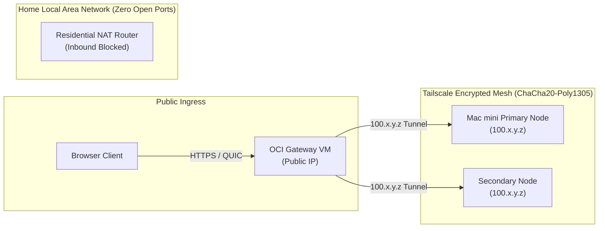

Traditional self-hosting requires opening ports 80 and 443 on your home router, configuring dynamic DNS (DDNS), and exposing your residential IP address to port scanners and DDoS attacks. 

In the ExCloudVault.com architecture, the home network maintains **zero open ports**. Instead, all cross-boundary communications flow through an encrypted **Tailscale WireGuard mesh**.

---

## 1. Network Topology & Encryption Flow



### Why Tailscale WireGuard?
* **Zero Inbound Port Forwarding:** The Mac mini initiates an outbound UDP connection to Tailscale DERP relays or directly punches holes through NAT/CGNAT.
* **Kernel-Speed Performance:** Built upon WireGuard's modern cryptographic primitives (ChaCha20 for encryption, Poly1305 for authentication, Curve25519 for key exchange).
* **Deterministic Overlay IPs:** Every node receives a fixed private IPv4 address in the `100.64.0.0/10` CGNAT range that never changes when your public residential IP rotates.

---

## 2. Installing Tailscale on Nodes

### On the OCI Edge Gateway (Ubuntu)

```bash
# Add Tailscale package repository and install
curl -fsSL https://tailscale.com/install.sh | sh

# Enable IP forwarding (essential if routing subnets or proxying)
echo 'net.ipv4.ip_forward = 1' | sudo tee -a /etc/sysctl.d/99-tailscale.conf
echo 'net.ipv6.conf.all.forwarding = 1' | sudo tee -a /etc/sysctl.d/99-tailscale.conf
sudo sysctl -p /etc/sysctl.d/99-tailscale.conf

# Authenticate OCI node
sudo tailscale up --auth-key="tskey-auth-..." --hostname="oci-proxy" --accept-routes
```

### On the Mac mini (Apple Silicon / macOS)

Tailscale can be run either via the native macOS Menu Bar application or via the standalone CLI daemon:

```bash
# Verify connection
tailscale status
tailscale ping oci-proxy
```

---

## 3. Tailscale Access Control Lists (ACLs)

In the Tailscale Admin Console, define fine-grained ACLs to enforce least-privilege security between the edge reverse proxy and backend application servers:

```json
{
  "acls": [
    // Allow OCI Proxy to access designated backend ports on the Mac mini
    {
      "action": "accept",
      "src": ["tag:ingress"],
      "dst": [
        "tag:homelab-node:8008", // Coolify UI
        "tag:homelab-node:6001", // Reverb WebSockets
        "tag:homelab-node:6002", // Terminal WebSockets
        "tag:homelab-node:8080", // Nextcloud
        "tag:homelab-node:8888", // Microbin
        "tag:homelab-node:30000",// Karakeep
        "tag:homelab-node:443"   // Cosmos Gateway
      ]
    },
    // Admin access
    {
      "action": "accept",
      "src": ["group:admins"],
      "dst": ["*:*"]
    }
  ],
  "tagOwners": {
    "tag:ingress": ["group:admins"],
    "tag:homelab-node": ["group:admins"]
  }
}
```

---

## 4. Performance Tuning & Verification

### UDP Buffer & Fast Path Optimization
To maximize throughput for large file syncs (Nextcloud / Immich) over Tailscale on Linux:

```bash
# Optimize network buffers
sudo sysctl -w net.core.rmem_max=26214400
sudo sysctl -w net.core.wmem_max=26214400
```

### Direct vs. DERP Relay Check
Ensure your nodes achieve direct peer-to-peer WireGuard connections without relay overhead:

```bash
tailscale ping <MAC_MINI_TAILSCALE_IP>
```

Expected output:
```text
pong from mac-mini (100.x.y.z) via [your-home-external-ip]:41641 in 14ms (direct)
```

If it shows `via DERP(...)`, review your router's NAT UDP timeout settings to enable direct hole punching.
