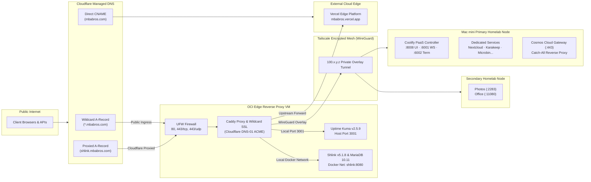
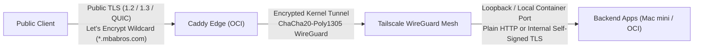

The **MBA Bros Private Cloud** is an enterprise-grade, zero-trust hybrid self-hosted infrastructure. It merges the reliability of a free cloud edge gateway with high-density, energy-efficient Apple Silicon computing hardware at home, connected over an encrypted WireGuard mesh.

---

## 1. High-Level Component Topology

---

## 2. Infrastructure Pillars

### A. Edge Gateway (Oracle Cloud Infrastructure Always-Free VM)
* **Compute:** OCI Always-Free ARM Ampere A1 (4 OCPUs, 24GB RAM, Ubuntu 22.04 LTS).
* **Ingress Engine:** Caddy with custom Cloudflare DNS module built-in via `xcaddy`.
* **Zero HTTP Validation:** Wildcard certificates (`*.mbabros.com`) are generated via Let's Encrypt using the Cloudflare DNS-01 ACME challenge. Port 80 is never used for domain validation.
* **Internal Health Monitoring:** Exposes a local healthcheck endpoint at `http://<OCI_VM_INTERNAL_IP>/healthz` returning HTTP 200 `"ok"`, polled by Uptime Kuma for heartbeat verification.

### B. Encrypted Mesh Overlay (Tailscale WireGuard)
* **Network Fabric:** Tailscale point-to-point mesh (`100.x.y.z`).
* **Zero Residential Inbound Ports:** The home router has **0 inbound ports forwarded**. CGNAT (Carrier-Grade NAT) and dynamic residential IPs are effortlessly handled via WireGuard stateful connections and Tailscale DERP relays.
* **Kernel-Level Encryption:** All transit between cloud reverse proxies and local homelab hardware is encrypted using ChaCha20-Poly1305.

### C. Apple Silicon PaaS Node (Mac mini M2)
* **Hardware:** Apple Silicon Mac mini with OrbStack lightweight container virtualization.
* **PaaS Engine:** [Coolify](https://coolify.io) running self-hosted container applications, databases, and scheduled backups.
* **Self-Hosted GitHub Runner:** Dedicated runner processing continuous integration and automated GitOps deployments directly on the hardware.

---

## 3. End-to-End SSL / TLS Boundary Model

1. **Public Edge Termination:** All public traffic terminates TLS at Caddy on the OCI VM using a Let's Encrypt wildcard certificate (`*.mbabros.com`).
2. **Overlay Transit Encryption:** WireGuard encrypts all traffic traversing the public internet between the OCI VM and homelab nodes using ChaCha20-Poly1305 authenticated encryption.
3. **No Double-SSL Overhead:** Tailscale provides network-level security, allowing homelab containers to run in high-performance HTTP mode without managing per-container Let's Encrypt certificates.
