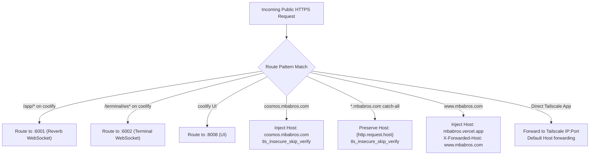

This document lists every service running in the MBA Bros Private Cloud, including ingress protocols, internal ports, upstream targets, and proxy strategies.

---

## 1. Complete Service Routing Table

| Subdomain / URL | DNS Ingress Source | Upstream Target | Host Node | Application / Purpose |
| :--- | :--- | :--- | :--- | :--- |
| `http://<OCI_VM_IP>/healthz` | Local Loopback / Private IP | Local Caddy Responder | OCI Gateway | Instant HTTP 200 `"ok"` healthcheck probe polled by Uptime Kuma. |
| `uptime.mbabros.com` | Wildcard A (`*.mbabros.com`) | `127.0.0.1:3001` | OCI Gateway | **Uptime Kuma v2.5.9** monitoring dashboard and status pages. |
| `shlink.mbabros.com` | Cloudflare A (Proxied) | `shlink:8080` (Docker DNS) | OCI Gateway | **Shlink v5.1.8** self-hosted URL shortener backed by MariaDB 10.11. |
| `www.mbabros.com` | Cloudflare A | `https://mbabros.vercel.app` | External Edge | Public marketing frontend; redirects to apex `mbabros.com`. |
| `mbabros.com` (Apex) | Cloudflare CNAME | Vercel DNS (`vercel-dns-017`) | External Edge | Production website frontend on Vercel Edge. |
| `coolify.mbabros.com` | Wildcard A | `<MAC_MINI_TAILSCALE_IP>` | Mac mini (Apple Silicon) | **Coolify PaaS Controller** (UI on `:8008`, Events WS on `:6001`, Shell WS on `:6002`). |
| `nextcloud.mbabros.com` | Wildcard A | `<MAC_MINI_TAILSCALE_IP>:8080` | Mac mini | **Nextcloud Enterprise Hub** (files, calendar, contacts). |
| `microbin.mbabros.com` | Wildcard A | `<MAC_MINI_TAILSCALE_IP>:8888` | Mac mini | **Microbin** encrypted text, snippet, and file pastebin. |
| `karakeep.mbabros.com` | Wildcard A | `<MAC_MINI_TAILSCALE_IP>:30000` | Mac mini | **Karakeep (Hoarder)** AI bookmarking and read-it-later engine. |
| `homedock.mbabros.com` | Wildcard A | `<MAC_MINI_TAILSCALE_IP>:8088` | Mac mini | **Homedock** Docker container management portal. |
| `immich.mbabros.com` | Wildcard A | `<MAC_MINI_TAILSCALE_IP>:8081` | Mac mini | **Immich** high-performance self-hosted photo management. |
| `paperless.mbabros.com` | Wildcard A | `<MAC_MINI_TAILSCALE_IP>:8086` | Mac mini | **Paperless-ngx** automated OCR document indexer. |
| `onlyoffice.mbabros.com` | Wildcard A | `<MAC_MINI_TAILSCALE_IP>:7400` | Mac mini | **OnlyOffice Document Server** collaborative editor. |
| `photos.mbabros.com` | Wildcard A | `<SECONDARY_TAILSCALE_IP>:2283` | Secondary Node | Secondary photo processing and sync node. |
| `office.mbabros.com` | Wildcard A | `<SECONDARY_TAILSCALE_IP>:11080` | Secondary Node | **Collabora Online** office suite backend. |
| `cosmos.mbabros.com` | Wildcard A | `<MAC_MINI_TAILSCALE_IP>:443` | Mac mini | **Cosmos Cloud Gateway** with strict `Host` header injection. |
| `*.mbabros.com` (Catch-all) | Wildcard A | `<MAC_MINI_TAILSCALE_IP>:443` | Mac mini | Dynamic wildcard pass-through for ad-hoc container deployments. |

---

## 2. Header Transformation Rules

Depending on upstream application requirements, Caddy transforms headers during reverse proxying:

### Why Specific Header Injections Are Required

* **Cosmos Cloud Host Validation:** Cosmos validates incoming HTTP `Host` headers. If an untrusted or mismatched Host header is forwarded, it responds with `400 Bad Request: Invalid hostname`. Caddy explicitly sets `header_up Host cosmos.mbabros.com` to guarantee validation passes.
* **Vercel Virtual Host Routing:** Edge platforms like Vercel route traffic based on the HTTP `Host` header. Caddy rewrites the upstream host to `mbabros.vercel.app` while retaining `X-Forwarded-Host: www.mbabros.com`.
* **Coolify Real-time WebSockets:** Coolify requires dedicated paths for Laravel Reverb (`/app/*` on port `6001`) and interactive terminal sessions (`/terminal/ws*` on port `6002`). Dedicated matchers in Caddy ensure bi-directional WebSocket streams are never downgraded or dropped.
