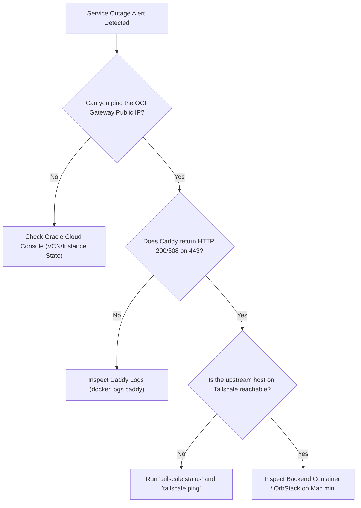

When managing a hybrid private cloud across cloud gateways and residential nodes, standard debugging procedures help isolate issues rapidly. Use these runbooks to diagnose and resolve outages.

---

## 1. Diagnostic Decision Tree



---

## 2. Common Scenarios & Triage Runbooks

### Runbook A: Caddy Fails to Issue Wildcard Certificates
* **Symptom:** Browser shows `NET::ERR_CERT_COMMON_NAME_INVALID` or `525 SSL Handshake Failed`.
* **Root Causes:**
  1. The Cloudflare API token expired or lacks `Zone.DNS:Edit` permissions.
  2. The `CF_API_TOKEN` environment variable is not passed into the container.
* **Commands:**
  ```bash
  # Check Caddy logs for ACME errors
  docker logs caddy --tail 50 | grep -i acme

  # Validate Cloudflare API token manually
  curl -X GET "https://api.cloudflare.com/client/v4/user/tokens/verify" \
       -H "Authorization: Bearer <YOUR_CLOUDFLARE_API_TOKEN>" \
       -H "Content-Type: application/json"
  ```

---

### Runbook B: Tailscale Mesh Connectivity Loss
* **Symptom:** Caddy logs report `dial tcp 100.x.y.z:port: i/o timeout` or `502 Bad Gateway`.
* **Root Causes:**
  1. Node key expired in Tailscale admin console.
  2. The Mac mini entered sleep mode (power assertions disabled).
* **Commands:**
  ```bash
  # On OCI Gateway: test mesh ping
  tailscale ping <MAC_MINI_TAILSCALE_IP>

  # Check active peer table
  tailscale status

  # On Mac mini: verify caffeinate / sleep prevention
  pmset -g assertions
  ```

---

### Runbook C: Coolify WebSockets Disconnecting
* **Symptom:** Live deployment logs freeze or the web terminal shows `Connection closed (error 1006)`.
* **Root Cause:** Caddy is missing the `/app/*` or `/terminal/ws*` path matchers and attempting standard HTTP buffering instead of full WebSocket upgrades.
* **Fix:** Ensure your `Caddyfile` contains:
  ```nginx
  @ws_events path /app/*
  handle @ws_events {
      reverse_proxy 100.x.y.z:6001
  }
  @ws_term path /terminal/ws*
  handle @ws_term {
      reverse_proxy 100.x.y.z:6002
  }
  ```

---

### Runbook D: Cosmos Cloud Returns "400 Bad Request: Invalid Hostname"
* **Symptom:** Browsing to `https://cosmos.mbabros.com` throws HTTP 400.
* **Root Cause:** Cosmos validates the `Host` header strictly against its configured domain. If the reverse proxy forwards a generic host or IP, Cosmos rejects the request.
* **Fix:** Add `header_up Host cosmos.mbabros.com` to your Caddy reverse proxy block.
